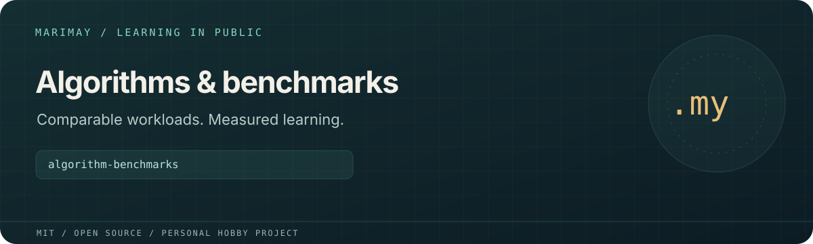

# algorithm-benchmarks



> **Personal learning project.** This open-source MIT project is part of
> [Marimay](https://github.com/marimay-lang/marimay), my hobby programming-language project.
> I maintain it in my spare time to learn by building. APIs and tooling may
> change, and progress may be intermittent.

Algorithms and application workloads in Marimay, Go and Rust, with optional
local comparisons in TypeScript/Bun, V and MoonBit. The corpus explores data
models, collections, errors and runtime behavior through deterministic checksums.

**Status:** Experimental learning and measurement corpus. Reports apply to their recorded
toolchain, revision, machine and methodology. Platform acceptance and performance
work remain in progress.

## Run and verify

```sh
MMAY=/absolute/path/to/mmay ./verify.sh
python3 -m unittest discover -s benchmarks -p 'test_*.py'
MMAY=/absolute/path/to/release/mmay make benchmark-catalog-smoke
MMAY=/absolute/path/to/release/mmay make benchmark
```

Install Python 3, Go, Rust/Cargo and a compatible Marimay compiler. The required
Marimay contract is recorded in
[`benchmarks/marimay-toolchain.json`](benchmarks/marimay-toolchain.json) and checked
before builds or measurements. Optional language participants need their own
toolchains.

Verification includes source checks, tests, VM/native comparisons, cross-language
checksums and harness checks. Runtime measurements exclude build time. The default
algorithm comparison uses Marimay, Go and Rust; optional participants have separate
local scopes.

See [`benchmarks/README.md`](benchmarks/README.md) for methodology,
[`benchmarks/CATALOG.md`](benchmarks/CATALOG.md) for application workloads, and
[`benchmarks/results/`](benchmarks/results/) for recorded reports. Historical
reports retain their original evidence and limitations.

## License

[MIT](LICENSE). Existing copyright attribution is retained.
